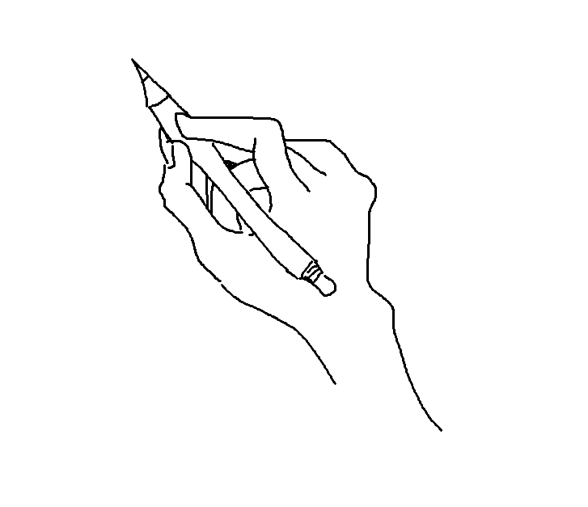

# High-Five

High-Five is a real-time multiplayer drawing and guessing game. Players take turns drawing a secret word while everyone else races to guess it in chat.

<p align="center">
  
</p>

## How to play

1. Enter a nickname and join an available room.
2. The drawer sees a random topic and sketches it on the shared canvas. Other players see only `???`.
3. Guess in chat; use **Answer** to submit a guess. A correct guess earns 3 points and ends the round.
4. Play five rounds, then check the final scores.

The canvas includes pen colors, an eraser, and undo. Drawing, chat, scores, and round timers are synchronized live.

## Run locally

Requirements: Node.js and Docker with Compose.

Start Redis, the Socket.IO game servers, and the Nginx load balancer from the project root:

```bash
docker compose up --build
```

In another terminal, start the client:

```bash
cd Client
npm install
npm run dev
```

Open the Vite URL shown in the terminal (usually `http://localhost:5173`). The client connects to `http://localhost` by default; set `VITE_SOCKET_URL` in `Client/.env` to change the server address.

## Tech stack

- **Client:** React, Vite, Zustand, Socket.IO Client
- **Server:** Node.js, Express, Socket.IO
- **Infrastructure:** Redis, Socket.IO Redis adapter, Nginx, Docker Compose
